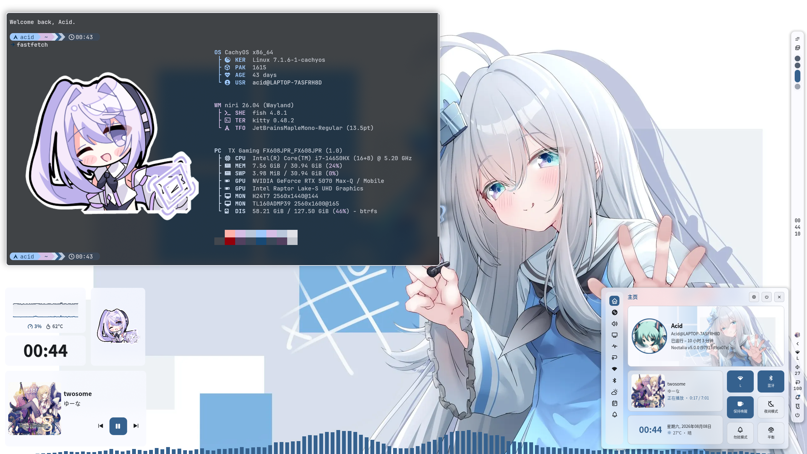
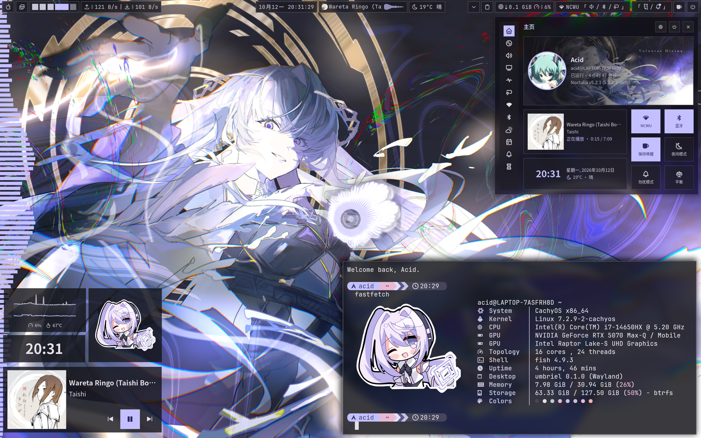

# Niri / Umbriel × Noctalia Wayland Dotfiles

个人的 CachyOS + Wayland 桌面配置。仓库结构直接**镜像家目录**：

- `dotfiles/.config/` → `~/.config/`
- `dotfiles/.local/bin/` → `~/.local/bin/`

全部通过软链接部署，改仓库即改系统配置；安装脚本逐项、原子地替换链接，不会一次性删光配置。

> **2026-11 重构**：此前是按「Noctalia / DMS 双会话」维护的，现已不再维护 DMS（DankMaterialShell）会话。
> 现在桌面 = **合成器 + Noctalia 外壳** 的组合：
>
> | 组合 | 合成器 | 外壳 | 入口 |
> | --- | --- | --- | --- |
> | **Niri + Noctalia**（主力） | niri | noctalia | `niri-noctalia-session` |
> | **Umbriel + Noctalia** | umbriel | noctalia | `start-umbriel` |
>
> `DankMaterialShell/`、`bin/`、`wayland-sessions/` 不再纳入版本管理，仅在本机保留。

## 📖 简介

- **组合式桌面**：合成器只负责窗口管理，Noctalia 负责面板、启动器、壁纸、配色等外壳能力，两者通过各自的配置解耦。
- **动态主题配色**：Matugen 读取当前壁纸提取主色，生成 kitty / fastfetch / GTK / fuzzel / btop / cava / starship / yazi 等全套配色。
- **壁纸钩子联动**：Noctalia 换壁纸后触发 matugen 脚本，自动重载主题。
- **随机动漫壁纸**：`Mod+Shift+F10` 异步下载并切换壁纸，切换后触发配色钩子。
- **镜像家目录的仓库结构**：一眼看出每个文件最终落在系统哪里，迁移、备份、回滚都很直接。

## 🖼️ 效果预览




## 📁 目录结构

```Plain Text
dotfiles/
├── .config/                       # → ~/.config（逐项软链接）
│   ├── niri/                      # Niri 合成器：noctalia 会话配置
│   │   ├── niri-noctalia.kdl      # 会话主配置（include noctalia/*.kdl）
│   │   ├── noctalia/              # 拆分的模块：layout/binds/blur/…
│   │   ├── cfg/                   # 通用基础片段
│   │   ├── scripts/               # niri 辅助脚本（截图音效、窗口拾取、硬杀窗口）
│   │   ├── dms/                   # DMS 时期的历史片段（保留备用）
│   │   └── config.kdl             # 单文件版历史配置
│   ├── umbriel/                   # Umbriel 合成器配置
│   │   ├── config.toml            # 主配置（include modules/*.toml，autostart 拉起 noctalia）
│   │   ├── modules/               # binds/layout/blur/windowrules/…
│   │   └── scripts/               # maximized-bar.sh、umbriel-screenshot
│   ├── noctalia/                  # Noctalia 外壳配置
│   │   ├── noctalia-config.toml   # 主配置（含 [hooks] 壁纸钩子）
│   │   ├── colors.json / plugins.json
│   │   └── scripts/               # matugen 配色、outputs 生成、mpv 钩子
│   ├── matugen/                   # 动态配色：config.toml + templates/
│   ├── fish/                      # Fish 配置（completions/conf.d/functions）
│   ├── kitty/                     # Kitty 终端配置与主题
│   ├── nvim/                      # Neovim（Lazy）配置
│   ├── superfile/                 # Superfile 文件管理器
│   ├── fastfetch/                 # 系统信息展示（logo 为 ~/Pictures 的链接）
│   ├── xdg-desktop-portal/        # niri-portals.conf
│   ├── mimeapps.list              # 默认应用关联
│   ├── user-dirs.dirs / user-dirs.locale
│   └── xdg-terminals.list
├── .local/bin/                    # → ~/.local/bin（逐项软链接）
│   ├── random-anime-wallpaper-noctalia  # 随机动漫壁纸（当前）
│   └── random-anime-wallpaper-dms       # 随机壁纸（DMS 时期，保留备用）
├── bin/                           # 仅本地：会话启动器 → /usr/local/bin
├── wayland-sessions/              # 仅本地：桌面入口 → /usr/share/wayland-sessions
├── Preview/                       # 效果图
├── install.sh                     # 一键部署 / 校验
├── .gitignore
└── README.md
```

**只在本机、不入库的部分**（`.gitignore` 中已忽略）：

| 路径 | 用途 |
| --- | --- |
| `bin/` | 会话启动器，部署到 `/usr/local/bin/` |
| `wayland-sessions/` | `.desktop` 入口，部署到 `/usr/share/wayland-sessions/` |
| `.config/DankMaterialShell/` | 已弃用的 DMS 配置，仅本地留存 |
| `.config/kitty/themes`、`fastfetch/config.jsonc` 等 | 运行时由 Matugen 生成 |

## ⚙️ 安装与校验

```bash
cd ~/dotfiles

./install.sh              # 链接 .config/* → ~/.config，.local/bin/* → ~/.local/bin
sudo ./install.sh --system  # 额外部署 bin/* 与 wayland-sessions/*.desktop
./install.sh --check      # 只校验链接，不改动任何文件
```

安装规则：

1. 逐项处理，不批量删除；
2. 已指向正确位置的链接直接跳过；
3. 旧链接用「临时链接 + rename」原子覆盖，避免出现链接已断的窗口期；
4. 目标位置若是实体文件/目录，先备份为 `<name>.bak-<时间戳>` 再建立链接。

## 🔧 启动链路

```Plain Text
greetd
├─ niri-noctalia.desktop
│   └─ /usr/local/bin/niri-noctalia-session
│       └─ niri -c ~/.config/niri/niri-noctalia.kdl
│           └─ autostart: noctalia（外壳 / 面板 / 壁纸）
└─ umbriel.desktop
    └─ /usr/bin/start-umbriel
        └─ ~/.config/umbriel/config.toml
            └─ autostart: noctalia（外壳 / 面板 / 壁纸）
```

## 🎨 配色生成机制

1. 壁纸变化 → Noctalia 触发 `[hooks] wallpaper_changed`
2. 执行 `~/.config/noctalia/scripts/matugen/matugen.sh`
3. 读取 `~/.config/noctalia/scripts/matugen/config.json` 的配色规则
4. Matugen 按 `~/.config/matugen/config.toml` 的模板渲染，写回各应用配置
5. 终端 / GTK / fastfetch / btop / cava 等即时换色

`theme_mode_changed` 钩子预留了 `~/.config/noctalia/theme-sync.sh` 入口（可选，不存在时不影响壁纸配色）。

## 🌊 随机壁纸

- Noctalia：`Mod+Shift+F10` → `~/.local/bin/random-anime-wallpaper-noctalia` → `noctalia msg wallpaper-set` → 触发配色钩子
- DMS 时期：`random-anime-wallpaper-dms`，调用 `dms ipc call wallpaper set`，保留备用

## 📌 依赖

- 合成器：`niri` 或 `umbriel`
- 外壳：`noctalia`
- 配色：`matugen`
- 其他：`fish`、`kitty`、`nvim`、`superfile`、`fastfetch`、`fcitx5`、`greetd`
- 环境：Linux（CachyOS）、Wayland

## 🔄 后续计划

- 清理 `niri/dms/`、`config.kdl` 等 DMS 时期遗留配置
- 把配色钩子封装为 Noctalia 插件，摆脱硬编码脚本路径
- 壁纸脚本收敛为单一实现，用参数区分合成器
